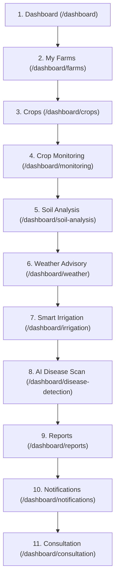

# AgriSense – Application Workflow, Navigation Hierarchy & Architecture Alignment

## 1. Executive Summary

AgriSense is an intelligent precision agriculture and farm management platform designed for farmers, agricultural extension specialists, and system administrators. The platform establishes a structured, step-by-step agricultural journey spanning farm parcel creation, crop lifecycle management, IoT soil and telemetry monitoring, hyper-local agro-meteorology, automated irrigation scheduling, AI-powered disease diagnosis, and specialist consultations.

This document details the restructured sidebar architecture, the logical farmer workflow, upstream/downstream data dependencies, route mappings, role-based access rules, and current implementation statuses across the 15 UI reference screens.

---

## 2. Logical Farmer Journey & Workflow Dependencies

The platform organizes farmer activities into a sequential, dependent lifecycle journey:



### Upstream and Downstream Data Dependencies:

1. **Dashboard (`/dashboard`)**:
   - Aggregates live metrics from registered farms, active crop stages, harvest countdowns, and system connectivity.
2. **My Farms (`/dashboard/farms`)**:
   - **Foundational Root Entity**: Every agricultural activity requires a registered farm parcel (`Farm` document in MongoDB).
   - Captures acreage, soil type, irrigation setup, and geographic coordinates.
3. **Crops (`/dashboard/crops`)**:
   - **Prerequisite**: A crop record (`Crop` document) must belong to an existing farmer-owned farm (`farmId` foreign key).
   - Tracks seed varieties, sowing dates, phenological growth stages (Germination through Harvest), and planned acreage.
4. **Crop Monitoring (`/dashboard/monitoring`)**:
   - **Prerequisite**: Requires registered crop records and field hardware sensors.
   - Evaluates canopy vigor (NDVI/NDRE) and biomass stress curves against registered crops.
5. **Soil Analysis (`/dashboard/soil-analysis`)**:
   - **Prerequisite**: Associated with a specific farm parcel and crop soil zone.
   - Evaluates underground telemetry (NPK, pH, depth moisture at 10cm, 30cm, 60cm).
6. **Weather Advisory (`/dashboard/weather`)**:
   - **Prerequisite**: Utilizes farm location coordinates (state, district, village, or GPS) to fetch hyper-local forecasts and spray-window warnings.
7. **Smart Irrigation (`/dashboard/irrigation`)**:
   - **Prerequisite**: Combines crop water coefficients, soil moisture readings, and meteorological rainfall forecasts to automate irrigation pump cycles.
8. **AI Disease Scan (`/dashboard/disease-detection`)**:
   - **Prerequisite**: Accepts authentic camera leaf uploads; diagnosis results attach to corresponding registered crop entities.
9. **Reports (`/dashboard/reports`)**:
   - **Prerequisite**: Aggregates historical harvest yields, input expenditures, and field performance over time.
10. **Notifications (`/dashboard/notifications`)**:
    - **Prerequisite**: Dispatched from real application events (sensor limit violations, storm warnings, agronomist consultation responses).
11. **Consultation (`/dashboard/consultation`)**:
    - **Prerequisite**: Connects verified farmers with accredited agronomy specialists, allowing leaf scan attachments and historical soil telemetry forwarding.

> [!NOTE]
> When optional telemetry or hardware data is unavailable, unrelated platform functionality remains fully operable without artificial blocks. Simulated or fake sensor connectivity is strictly prohibited.

---

## 3. Restructured Sidebar Navigation Hierarchy

The sidebar is categorized into five distinct semantic groups with consistent styling, accessibility labels, and active route indicators:

### 1. OVERVIEW
- **Dashboard** (`/dashboard`): Central executive overview of all farmer parcels, active crop growth stages, and telemetry hardware status.

### 2. FARM MANAGEMENT
- **My Farms** (`/dashboard/farms`): Comprehensive directory of registered farm parcels with search, status filtering, sort, and CRUD actions.
  *(Note: Duplicate "Live" navigation badge removed; farm parcels are distinguished from sensor telemetry streams).*
- **Crops** (`/dashboard/crops`): Crop registration, phenological stage trackers, and harvest calendar.
- **Crop Monitoring** (`/dashboard/monitoring`): Dedicated real-time vegetation indices and field camera feeds.

### 3. PRECISION AGRICULTURE
- **Soil Analysis** (`/dashboard/soil-analysis`): Underground sensor diagnostics (NPK, pH, electrical conductivity, moisture depth).
- **Weather Advisory** (`/dashboard/weather`): Hyper-local micro-climate forecasts, frost alerts, and 7-day spray conditions.
- **Smart Irrigation** (`/dashboard/irrigation`): Evapotranspiration-based automated watering schedules and valve solenoid controls.
- **AI Disease Scan** (`/dashboard/disease-detection`): Computer-vision-powered leaf pathology scanner with severity grading.

### 4. ACTIVITY & SUPPORT
- **Reports** (`/dashboard/reports`): Exportable PDF/CSV seasonal audits, input vs. yield efficiency matrices.
- **Notifications** (`/dashboard/notifications`): Threshold breach alarms, weather emergency notices, and agronomist updates.
- **Consultation** (`/dashboard/consultation`): Structured inquiry portal linking farmers directly to agronomy extension experts.

### 5. ACCOUNT & SESSION
- **Settings** (`/dashboard/settings`): Alert thresholds, unit configurations, and integration webhooks.
- **Profile** (`/dashboard/profile`): Farmer credentials, contact details, and location preferences.
- **Landing Page** (`/`): Secondary external link back to the public homepage.
- **Sign Out**: Clears JWT token and redirects safely to the login screen.

---

## 4. Comprehensive 15-Screen Route Mapping & Status

| # | Screen Name | Route Path | Authorized Roles | Current Status | Notes |
| :---: | :--- | :--- | :--- | :--- | :--- |
| **01** | Landing Page | `/`, `/about`, `/features` | Public | **Fully Functional** | Responsive hero, authentic photography, feature showcases |
| **02** | Login & Registration | `/login`, `/register` | Public (Unauthenticated) | **Fully Functional** | JWT auth, bcrypt hashing, role validation, duplicate protection |
| **03** | Farmer Dashboard | `/dashboard` | Farmer, Admin | **Fully Functional** | Real MongoDB farm/crop stats, hardware status banner |
| **04** | My Farms Directory | `/dashboard/farms` | Farmer, Admin | **Fully Functional** | Search, filter, sort, grid/list view, real MongoDB records |
| **05** | Add Farm Registration | `/dashboard/farms/new`, `/dashboard/farms/add` | Farmer, Admin | **Fully Functional** | Acreage validation, soil type, irrigation, MongoDB persistence |
| **06** | Farm Details & Submodules | `/dashboard/farms/:id` | Farmer, Admin | **Fully Functional** | Single-farm inspection, edit, and soft-archive controls |
| **07** | Crop Management | `/dashboard/crops` | Farmer, Admin | **Partially Implemented** | Mongoose `Crop` model live, dashboard overview active, list page in progress |
| **08** | Crop Telemetry Monitoring | `/dashboard/monitoring` | Farmer, Admin | **UI Placeholder** | Awaiting IoT hardware ingestion pipeline |
| **09** | Soil Health & NPK | `/dashboard/soil-analysis` | Farmer, Admin | **UI Placeholder** | Sensor threshold schemas designed |
| **10** | Smart Irrigation Control | `/dashboard/irrigation` | Farmer, Admin | **UI Placeholder** | Evapotranspiration formula integration planned |
| **11** | Weather & Agro-Meteorology | `/dashboard/weather` | Farmer, Admin | **UI Placeholder** | OpenWeatherMap / IMD API integration planned |
| **12** | AI Disease Detection | `/dashboard/disease-detection` | Farmer, Expert, Admin | **UI Placeholder** | Mobile image upload UI active, vision model planned |
| **13** | Expert Consultation Hub | `/dashboard/consultation`, `/expert/consultations` | Farmer, Expert, Admin | **UI Placeholder** | Structured inquiry schema planned |
| **14** | Admin Management & Users | `/admin/dashboard`, `/admin/users`, `/admin/farms` | Admin Only | **UI Placeholder** | User governance and oversight shells active |
| **15** | Reports & System Settings | `/dashboard/reports`, `/dashboard/settings` | Farmer, Admin | **UI Placeholder** | PDF export and notification configs planned |

---

## 5. Responsive Sidebar Implementation

1. **Collapsible Desktop Sidebar**:
   - Full expanded view (`w-72`) displaying all group headings, item descriptions, and status cards.
   - Compact collapsed view (`w-20`) displaying icon-only tooltips for maximum screen real estate.
   - State persisted across sessions in browser `localStorage` (`agrisense_sidebar_collapsed`).
   - Quick Action button transforms into an accessible centered `+` button in collapsed mode.
2. **Mobile Handheld Drawer**:
   - Slide-over backdrop drawer (`fixed inset-0 z-40 bg-slate-900/40 backdrop-blur-xs`) triggered via hamburger menu.
   - Smooth animated slide transition (`translate-x-0` / `-translate-x-full`).
   - Automatically closes upon navigation link clicks.
3. **Dynamic Top Navbar Breadcrumbs**:
   - Automatically parses current React Router location to show breadcrumb traces (e.g., `Farm Management / My Farms / Add Farm`) and active page headings.
   - Includes intuitive `ArrowLeft` back buttons on multi-step creation/edit subroutes.

---

## 6. Role-Based Access Control (RBAC) Architecture

```mermaid
graph TD
    User([User Request]) --> Guard{ProtectedRoute}
    Guard -->|Unauthenticated| Login[/login]
    Guard -->|Role: Farmer| FarmerPortal["/dashboard/* (Farmer Portal)"]
    Guard -->|Role: Expert| ExpertPortal["/expert/* (Expert Portal)"]
    Guard -->|Role: Admin| AdminPortal["/admin/* (Admin Suite)"]

    FarmerPortal -.->|Blocked| ExpertPortal
    FarmerPortal -.->|Blocked| AdminPortal
    ExpertPortal -.->|Blocked| AdminPortal
```

- **Strict Isolation**: Farmers can access only their own farm and crop documents (IDOR protection on all `/api/farms` and `/api/dashboard` routes).
- **No Self-Assigned Admins**: Public registration forbids `'admin'`; only `'farmer'` and `'expert'` roles can be registered from the client.
- **Fast Session Recovery**: Expired or invalid JWT tokens redirect cleanly to `/login` without application crashes.
