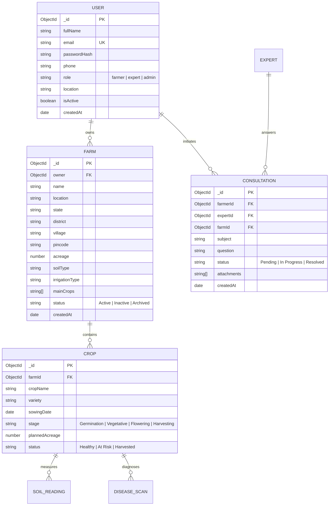

# AgriSense – Application Workflow & Architecture Alignment

## 1. Executive Summary

AgriSense is an intelligent agriculture IoT and precision management platform designed to help farmers optimize yields, monitor soil and crop telemetry, manage farm boundaries, track weather risks, and consult with agricultural specialists.

This document establishes the end-to-end architectural alignment, role-based navigation model, route mappings, database entities, and future module roadmaps matching the 15-screen UI reference specification.

---

## 2. Platform Architecture & Technology Stack

The platform is constructed on a decoupled modern web architecture:

```
┌────────────────────────────────────────────────────────┐
│               Client Tier (React 19 + Vite)            │
│  - Tailwind CSS 4.x       - Lucide React               │
│  - React Router DOM 7.x   - Recharts                   │
│  - Axios Client + Interceptors for JWT Bearer Tokens   │
└──────────────────────────┬─────────────────────────────┘
                           │ HTTP / JSON REST APIs (Bearer JWT)
┌──────────────────────────▼─────────────────────────────┐
│             Application Server (Express.js / Node.js)   │
│  - JWT Middleware (protect, authorize)                 │
│  - Security: Helmet, CORS, Express-Rate-Limit          │
│  - Controllers: Auth, Farm, Health, Analytics           │
└──────────────────────────┬─────────────────────────────┘
                           │ Mongoose ODM Driver
┌──────────────────────────▼─────────────────────────────┐
│                 Data Persistence Tier                   │
│  - MongoDB Atlas (Database: agrisense)                 │
│  - Indexes: Email (unique), Farm Owner, Geospatial     │
└────────────────────────────────────────────────────────┘
```

---

## 3. Role-Based Access Control (RBAC) Specification

AgriSense enforces a 3-tier Role-Based Access Control model:

| Capability / Resource | Farmer | Expert | Admin |
| :--- | :---: | :---: | :---: |
| **Public Landing & Authentication** | ✅ | ✅ | ✅ |
| **Personal Farmer Dashboard** | ✅ | ❌ | ❌ |
| **Farm Management (CRUD)** | ✅ (Owned Only) | ❌ | ✅ (All Farms) |
| **Crops & Telemetry View** | ✅ (Owned Farms) | ✅ (Assigned) | ✅ (All) |
| **Soil Analysis & Irrigation Controls** | ✅ | ❌ | ✅ |
| **AI Disease Detection Scanner** | ✅ | ✅ (Reviewer) | ✅ |
| **Farmer Consultation Portal** | ✅ (Ask Questions) | ✅ (Answer Queue) | ✅ (Oversight) |
| **Expert Portal & Consultation Inbox** | ❌ | ✅ | ✅ |
| **Admin Control Plane & User Directory** | ❌ | ❌ | ✅ |
| **System Settings & Global Diagnostics** | ❌ | ❌ | ✅ |

### Security Guarantees:
1. **Admin Creation Restricted**: Registration API strictly forbids self-assigned `'admin'` role; only `'farmer'` and `'expert'` can register publicly.
2. **Horizontal IDOR Protection**: Farmers can strictly view and edit only farms whose `owner` ObjectId matches `req.user._id`.
3. **Route Guards**: `ProtectedRoute` on the frontend validates both token presence and role authorization, instantly redirecting unauthorized attempts back to the appropriate user portal.

---

## 4. Comprehensive 15-Screen Route Mapping

The following 15 functional screens constitute the AgriSense platform:

| # | Screen Name | Route Path | Authorized Roles | Module Status |
| :---: | :--- | :--- | :--- | :--- |
| **01** | Landing Page | `/`, `/about`, `/features` | Public | **Completed (Phase 1 & 3)** |
| **02** | Login & Registration | `/login`, `/register` | Public (Unauthenticated) | **Completed (Phase 2)** |
| **03** | Farmer Dashboard | `/dashboard` | Farmer | **Completed (Phase 1 & Real Data)** |
| **04** | My Farms Directory | `/dashboard/farms` | Farmer, Admin | **Completed (Phase 4)** |
| **05** | Add Farm Registration | `/dashboard/farms/new`, `/dashboard/farms/add` | Farmer, Admin | **Completed (Phase 4)** |
| **06** | Farm Details & Submodules | `/dashboard/farms/:id` | Farmer, Admin | **Completed (Phase 4)** |
| **07** | Crop Management | `/dashboard/crops` | Farmer, Admin | Planned (Phase 5) |
| **08** | Crop Telemetry Monitoring | `/dashboard/monitoring` | Farmer, Admin | Planned (Phase 6) |
| **09** | Soil Analysis & Diagnostics | `/dashboard/soil-analysis` | Farmer, Admin | Planned (Phase 6) |
| **10** | Smart Irrigation Control | `/dashboard/irrigation` | Farmer, Admin | Planned (Phase 7) |
| **11** | Weather & Agro-Meteorology | `/dashboard/weather` | Farmer, Admin | Planned (Phase 7) |
| **12** | AI Disease Detection | `/dashboard/disease-detection` | Farmer, Expert, Admin | Planned (Phase 8) |
| **13** | Expert Consultation Hub | `/dashboard/consultation`, `/expert/consultations` | Farmer, Expert, Admin | Planned (Phase 8) |
| **14** | Admin Management & Users | `/admin/dashboard`, `/admin/users`, `/admin/farms` | Admin Only | Architectural Shell |
| **15** | Reports & System Settings | `/dashboard/reports`, `/dashboard/settings`, `/admin/settings` | Farmer, Admin | Architectural Shell |

---

## 5. Data Models & Entity Relationships



---

## 6. Implementation Phasing Strategy

- **Phase 1 (Completed)**: UI Foundation, Landing Page, Layouts, Design System.
- **Phase 2 (Completed)**: Secure Authentication (bcrypt, JWT, auth routes, cookies, verification tests).
- **Phase 3 (Completed)**: Visual Refresh, Authentic Agricultural Photography, Split-Screen Layouts.
- **Phase 4 (Completed)**: Farm Management (Full CRUD, Mongoose schema, validation, IDOR protection, 10 backend tests).
- **Current Alignment**:
  - Unified dynamic navigation supporting Farmer, Expert, and Admin roles.
  - Comprehensive RBAC route enforcement in React Router (`ProtectedRoute` with `allowedRoles`).
  - Farmer Dashboard aggregated with real MongoDB metrics (farms count, total acreage, active farms).
  - Cohesive design-system placeholders for future phases (Crops, Soil, Irrigation, AI, Expert Hub) ensuring zero broken links or 404s.
- **Phase 5 (Next)**: Crop Management (Full CRUD, growth staging, planting calendars).
- **Phase 6**: IoT Telemetry & Soil Health (Time-series data, NPK sensor ingestion, moisture thresholds).
- **Phase 7**: Smart Irrigation Automation & OpenWeatherMap / IMD Weather Integration.
- **Phase 8**: AI Crop Disease Detection (Leaf scan analysis, symptom severity, expert escalation).
- **Phase 9**: Consultation Messenger & Notification Center.
- **Phase 10**: Advanced Exportable PDF/CSV Reports and System Configuration.

